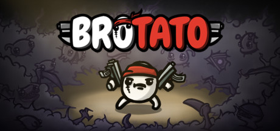

**Brotato is a bullet-hell survivor roguelite by Blobfish (2023).**

---

## 📖 About

Brotato is a bullet-hell survivor roguelite by Blobfish (2023). You play as a potato wielding up to 6 weapons simultaneously, surviving waves of aliens. Each run lasts 20 minutes with escalating difficulty, but later waves demand builds that are near-impossible without perfect item synergies.

## ⚠️ Problems Without Trainer

| Problem | Status |
|---------|--------|
| Elite enemies one-shot characters without max-level defensive synergies | ✅ Solved |
| RNG item shop fails to offer build-completing pieces at critical waves | ✅ Solved |
| Harvesting stats require heavy investment that cripples combat stats | ✅ Solved |
| Danger 5 unlocked characters have extremely punishing starting conditions | ✅ Solved |
| Consumables deplete before mid-wave without efficient movement routing | ✅ Solved |

## ✅ Solution

The **Brotato Trainer** solves all these issues, giving you complete control so you can focus on enjoying the game.

## 🎯 Features

- Unlimited Resources / Currency
- God Mode / Invincibility
- Instant Skill & Ability Cooldown
- One-Hit Kill
- Freeze Timers
- Unlock All Items & Achievements
- Custom Speed Multiplier
- Infinite Stamina / Energy

## 🚀 Quick Start

1. **Disable Windows Defender** temporarily (trainer may trigger false positive)
2. Get the trainer from the button above
3. Launch Brotato
4. Run the trainer as Administrator
5. Use the hotkeys to activate cheats in-game

## 💎 Free vs Pro

| Feature | Free | Pro |
|---------|------|-----|
| God Mode | ✅ | ✅ |
| Unlimited Resources | ✅ | ✅ |
| Advanced Cheats | ❌ | ✅ |
| Auto-Updates | ❌ | ✅ |
| Priority Support | ❌ | ✅ |

## 💻 Requirements

- Windows 10 / 11 (64-bit)
- Brotato (any version)
- .NET Framework 4.8+
- DirectX 11+

## 🍎 macOS

## ⚖️ Legal

Educational and single-player use only.

---

